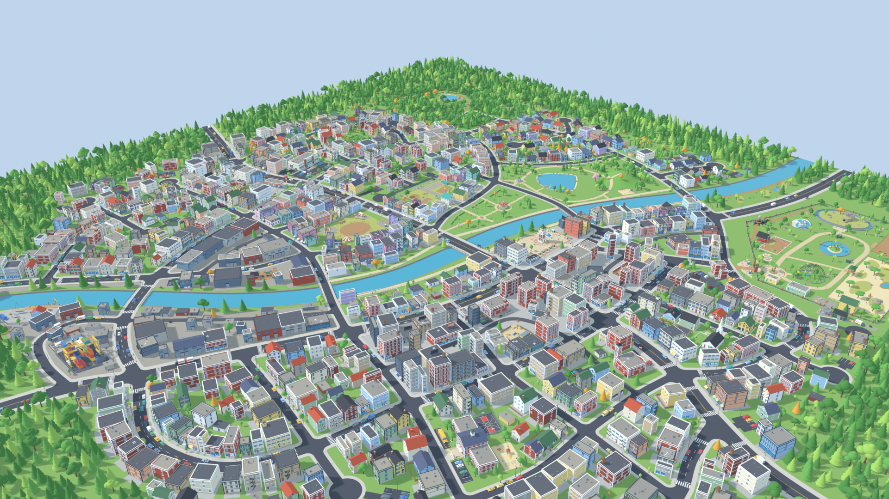
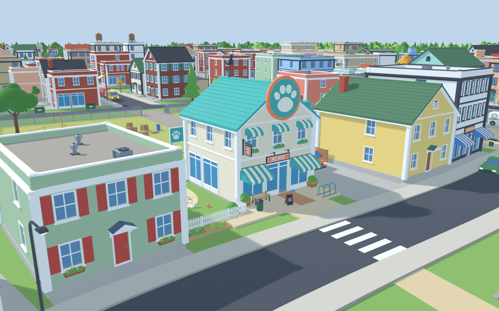
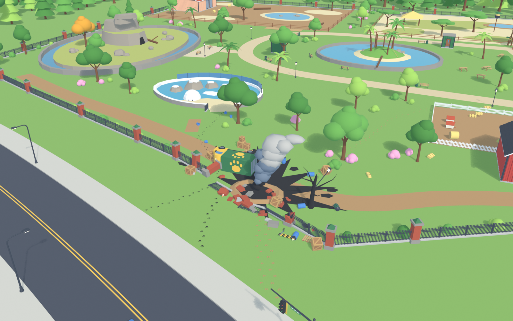
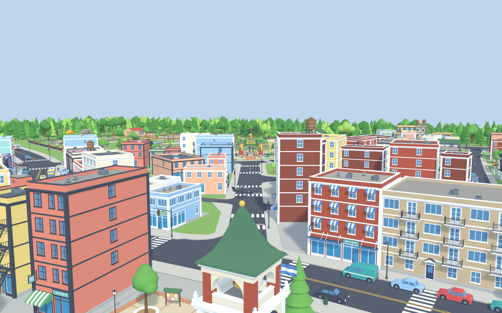

# Breed

**A cozy, slightly chaotic animal-catching game for Unity 6, at the start of production.** An incident at the city zoo lets animals escape all over town. You start with a small pet shop and explore the city to find and catch the escaped animals; small ones are easy, while big ones need teamwork or tools. You bring them back, care for them, sell or breed them, and grow the shop into a big business. It's planned for single-player and multiplayer.

| | |
|---|---|
|  |  |
|  |  |

*Willowbrook, the game's canal town, rendered straight from the Blender pipeline.*

---

## Status

The project started in October 2026.
- **The city foundation exists:** a procedural pipeline builds the whole town of **Willowbrook** in Blender from a hand-designed layout and exports it to Unity. The town has:
  - about 8.8 km of streets and 58 intersections;
  - 5 bridges over a 22 m canal;
  - 19 districts, and buildings assembled from a ~125-piece kit.
- **A densification pass followed the first review.** The first town read as a spread-out village, so the buildings now pack in like a busy town, and 8 civic anchors joined the landmarks:
  - a gas station, a supermarket and a diner;
  - a police station with animal control, a fire station, a school, a church and a vet clinic.
- **The Unity side** is still a fresh Unity 6 project; gameplay comes next.

## The city pipeline (`SourceArt/City`)

- **Designed by hand, built by code.** The layout is data: every road, district and landmark site in `layouts/layout_main.py` is placed deliberately, never at random. Python scripts running headless in Blender turn it into a clean, organized, Unity-friendly scene, phase by phase:
  1. **Terrain:** ground split by a canal, canal walls and water, ponds, a park hill, district plates.
  2. **Roads:** asphalt ribbons, filleted intersections, sidewalks and curbs, cul-de-sacs, lane paint, crosswalks and bridges.
  3. **A modular building kit:** walls, roofs, details, props and nature on a 3 m facade grid.
  4. **Buildings assembled from the kit** per district, with yards, fences and paths.
  5. **Landmarks:**
     - the pet shop (home base) and the zoo (where the incident starts);
     - Central Park, the town square, the service yard and the marina;
     - the civic anchors: shops, emergency services, a school, a church and a vet;
     - a lookout, hiding spots and more.
  6. **Street dressing:** street lights, trees, furniture, alley clutter, parked cars, traffic lights and an edge forest.
  7. **Gameplay markers:** player spawns, animal zones, hiding spots, the shop's expansion plot, the zoo incident and map exits.
- **Checked on every build.** A validator reports overlapping buildings, crossing roads and curves that are too tight. Each build writes review renders and a JSON report with the counts and timings.
- **Edit once, update everywhere.** Buildings and props are linked duplicates of kit meshes, so editing one kit piece updates every building. Custom properties (archetype, floors, habitat…) travel to Unity through FBX.
- **Ready for Unity.** `export_unity.py` writes one FBX per kit piece and the environment into `Export/Unity`, plus JSON for the instances, gameplay markers and root objects, the city manifest and the road graph.

## Tech stack

| Area | What it uses |
|---|---|
| Engine | **Unity 6** (6000.0.32f1) |
| City generation | **Python scripts running headless in Blender**: `build_city.py` with the `citygen` package |
| Level data | Hand-authored layout modules in `layouts/`, in meters on a ±350 m gameplay footprint |
| Look | One shared flat-colour palette (`citygen/palette.py`) that maps to Unity's Lit shader, with recolorable slots per building |
| Export | FBX per kit piece and for the environment, plus JSON manifests and the road graph |

## What I built

All of it: 45 Python files, about 22k lines.

| Part | Where |
|---|---|
| The build driver and its phases | `build_city.py`, `citygen/scene.py`, `config.py`, `finalize.py` |
| Terrain, roads, intersections and bridges | `citygen/terrain.py`, `roads.py`, `geom2d.py`, `meshutil.py` |
| The modular kit | `citygen/kit/` (`walls`, `roofs`, `details`, `props`, `nature`), `facade.py` |
| Building placement and assembly | `citygen/placement.py`, `assembler.py` |
| Landmarks | `citygen/landmarks/` (pet shop, zoo, park, town square, service yard, marina, lookout, courts, hiding spots, and the civic anchors in `civic_commerce` and `civic_services`), `lmkit.py` |
| Street dressing and gameplay markers | `citygen/dressing.py`, `markers.py` |
| Validation and review renders | `citygen/validate.py`, `render.py` |
| Unity export | `export_unity.py` |
| City layouts | `layouts/` (the main town, three candidate layouts, an empty and a test layout) |

## Docs

- [`SourceArt/City/README.md`](SourceArt/City/README.md): the pipeline, its phases, conventions and editing workflow
- [`SourceArt/City/docs/DESIGN_BRIEF.md`](SourceArt/City/docs/DESIGN_BRIEF.md): the game and the city's creative brief
- [`SourceArt/City/docs/DEV_SUMMARY.md`](SourceArt/City/docs/DEV_SUMMARY.md): what was built in each phase, and how the layout was chosen from three candidates by a panel of three judges
- `SourceArt/City/docs/reference/`: the visual references behind the densification pass
- [`SourceArt/City/docs/LAYOUT_SPEC.md`](SourceArt/City/docs/LAYOUT_SPEC.md), [`KIT_SPEC.md`](SourceArt/City/docs/KIT_SPEC.md), [`LANDMARK_SPEC.md`](SourceArt/City/docs/LANDMARK_SPEC.md): the layout schema, the kit and the landmark builders

## About this repository

This public repository is a **showcase**. It contains the documentation and the **48 source files I wrote** for this project. The complete project, with the generated Blender scene and the Unity export, is kept in a private repository.

Copyright © Omer Avcioglu (McHunter Studio). **All rights reserved.** Viewing only; see [LICENSE](LICENSE).
